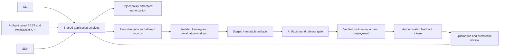

# MoroAI remediation blueprint

This document is a proposed engineering design based on the [verified audit](/Users/mac/Dev/MoroAI/moro/docs/audits/2026-10-02/REPORT.md). It is not a description of completed fixes. Its purpose is to turn the findings into implementation contracts and acceptance evidence.

## 1. Consolidate execution before adding features

Keep the real CLI implementations as the behavioral reference, then extract their orchestration into shared services. Avoid a rewrite of functioning hashing, dataset snapshot, strict-config and eligibility logic. Replace simulated SDK/dashboard implementations with calls into those services.

The browser should never submit a command string, arbitrary executable, SQL expression, host filesystem path or unvalidated configuration blob. It submits operation names and project-owned resource IDs. CLI users may still choose explicit local paths, but the web application must not inherit unrestricted CLI authority merely by wrapping it.

Suggested service contracts:

| Service | Input identity | Required output or failure |
|---|---|---|
| Compile | Source IDs, transform-policy version, glossary hash, split policy | Verified dataset manifest and disjoint split identities; missing source fails |
| Train | Dataset version, resolved base revision, effective recipe | Job/attempt ID; completed only after saved adapter validation |
| Evaluate | Artifact identity, suite hash, generation config, evaluator version | Case-level evidence with execution kind; missing model/suite fails |
| Package | Approved artifact fingerprint, format/transform recipe | Final inventory plus gate bound to the packaged bytes |
| Deploy | Release ID, runtime configuration, target slot | Runtime model digest and readiness/inference evidence |
| Learn | Claimed feedback IDs, preference policy, parent model | Durable reviewed dataset; a separate training job and promotion decision |

Return structured domain results instead of loosely shaped dictionaries with guessed fields. A simulation has its own explicit execution kind, visible label and artifact namespace. Reject simulation evidence anywhere a real model artifact or release approval is required.

## 2. Define the security boundary explicitly

For local use, require an installation-specific secret or authenticated session even when bound to loopback. Keep credentials out of URLs, logs and command history. For shared use, add authenticated identities and project membership; running behind a reverse proxy does not remove application authorization requirements. Enforce permission checks for every operation and every object lookup, including logs, previews, downloads and WebSockets. These principles follow [OWASP's authorization guidance](https://cheatsheetseries.owasp.org/cheatsheets/Authorization_Cheat_Sheet.html).

A practical starting permission model is below. Project ownership and artifact state further constrain each permission; a global role alone is insufficient.

| Capability | Viewer | Operator | Administrator |
|---|---:|---:|---:|
| View approved metrics and manifests | Yes | Yes | Yes |
| Read raw data or prompt logs | Separate sensitive-data grant | Separate grant | Separate grant |
| Upload/compile/start/cancel jobs | No | Within project and quota | Yes |
| Change policy or runtime credentials | No | No | Yes |
| Promote/rollback a release | No | Explicit deployment grant | Yes |
| Operate Docker | No | Only Moro-owned resources if explicitly granted | Scoped administration |
| Run arbitrary host commands | No | No | Outside the ordinary web API |

Use exact allowed Host/origin values, authenticated WebSocket handshakes and session expiry. If cookies carry identity, specify and test CSRF protection and cookie attributes. CORS must not become the authorization mechanism. Reject unknown policy/action combinations by default.

Keep the web process away from the Docker socket where possible. If a dedicated service manages containers, expose typed operations constrained to managed labels, supported images and predeclared volume/port profiles. Never accept an arbitrary container ID or privileged `docker run` argument set from a normal project request.

**Security acceptance:** unauthenticated requests start no subprocess and perform no read/write; a viewer cannot mutate state; project A cannot resolve project B's IDs; expired sessions and disallowed WS origins are denied; errors reveal no secret/path content. Test both terminal routes and every API alias so removing one vulnerable path does not leave the other.

## 3. Files, uploads and config are capabilities

Use server-generated storage IDs. Store the original filename as metadata, not as a destination path. Validate supported extensions and parse the actual content under size/time limits; client MIME types alone are not trustworthy. Authorize the operation before consuming a large body. Quarantine malformed or disallowed inputs without publishing them as usable datasets. These measures align with [OWASP's file-upload guidance](https://cheatsheetseries.owasp.org/cheatsheets/File_Upload_Cheat_Sheet.html).

Containment must hold at file-open time. A one-time resolved-path check followed by an ordinary open can race with a symlink change. Use directory-scoped, no-follow/exclusive filesystem operations where supported, and design a tested platform-specific fallback. Apply the same boundary to previews, deletes, output directories, manifests and existing directories. A suffix check on the submitted filename does not validate a separately supplied destination name.

For config writes: parse into the shared strict model, authorize policy changes, validate referenced resources, compare a revision/ETag, write a temporary file, durably replace it, and retain a recoverable prior version. Invalid input must leave the previous valid configuration byte-for-byte unchanged. Missing or invalid config should produce an error state, never raw-YAML fallback disguised as validated configuration.

**Acceptance:** traversal, absolute path, symlink, collision, invalid UTF-8/content and oversized upload cases fail without external writes; source names remain display-only. Two simultaneous config updates cannot silently overwrite each other. Numeric zero, false and empty values retain their meanings; absent values are represented explicitly.

## 4. Make jobs and recovery durable

Use a persistent job state machine:

`queued → claimed → running → validating_outputs → succeeded`

Failures lead to `failed`; cancellation leads through `cancelling → cancelled`; an expired worker lease leads to `interrupted`, then an explicit compatible retry/resume decision. A progress counter reaching 100 is not sufficient for success.

Each attempt should record immutable input hashes, requested and effective recipe, code/dependency identities, worker/process identity, start/end timestamps, heartbeat, exit status, resource measurements, checkpoint references and failure classification. Telemetry is append-only or versioned and derived from actual callbacks. Missing telemetry remains missing.

One worker owns an attempt through a lease. Resource admission uses available accelerator capacity and job limits. Cancellation addresses only that worker's owned process group. Never signal a reused PID without verifying ownership/start identity. A failed task must remain failed even if cleanup, telemetry or lineage registration also fails.

For OOM, distinguish model loading, forward/backward, evaluation and saving. Bound the number of retries and record the configuration of each. A retry in a fresh worker process provides a clear allocation-lifetime boundary. Batch/checkpointing changes may support checkpoint resume after compatibility checks; rank/target-module changes require a new training attempt with new provenance. Preserve user-visible effective batch and token-budget changes.

**Acceptance:** kill a worker during each phase; restart the supervisor; verify no false completion, no duplicate GPU assignment and no lost failure. A batch-one OOM cannot recurse indefinitely. CPU tests can inject failures to verify state transitions; actual memory recovery still requires CUDA hardware evidence.

## 5. Coordinate database records and filesystem publication

SQLite transactions do not make arbitrary external model/dataset files part of the same transaction. Its atomic-commit guarantees have a defined database/journal/filesystem scope; do not assume they cover application JSONL and model publication. [SQLite atomic-commit documentation](https://www.sqlite.org/atomiccommit.html).

Use an explicit recoverable publication protocol:

1. Reserve an immutable artifact/epoch ID and operation idempotency key in the DB.
2. Stage files under an operation-owned temporary directory; validate and hash every required output.
3. Write the manifest, record a prepared state and expected inventory.
4. Publish to an exclusive destination; never truncate a previously published artifact.
5. Commit the ready state referring to the exact manifest hash.
6. Acknowledge only the source records included in that committed artifact.

A reconciler handles interrupted states: prepared-but-unpublished can retry; published-but-uncommitted can validate and finish or quarantine; missing/mismatched bytes invalidate readiness. Document filesystem durability assumptions and test power/process failure behavior appropriate to the supported platforms. Do not delete unregistered artifacts silently when they may be the only recoverable output.

For feedback, add a unique source identity and extraction-policy/content identity. Use exact log IDs, not session IDs. Distinguish pending, claimed, deferred, rejected and consumed. Minimum thresholds and epoch caps defer eligible records; they do not acknowledge them. Training failure does not trigger deployment, and `require_eval_gate` does not grant permission to deploy.

**Acceptance:** the reproduced crash-before-ack case creates one logical pair on retry; repeated epoch IDs cannot overwrite; file/DB hashes agree after every injected failure; cap/minimum boundaries preserve pending work. Report extracted, accepted, deferred and rejected counts separately so totals reconcile.

## 6. Bind release policy to final artifacts

At gate time, identify the complete candidate: adapter/base revision/tokenizer/template, dataset and effective training recipe, evaluator/suite/decoding configuration and dependency environment. At packaging time, compare the copied source identity with that same approved identity. A newly self-consistent copy of different bytes is not sufficient.

A merged or quantized output is a derived artifact with its own transform recipe and hash. Evaluate or smoke-test that final output at the level needed for its claims. Package creation, runtime import, model loading and inference readiness are separate states. A running container with no loaded model is not a deployed model.

Promotion should transactionally verify the candidate first, then update a project/runtime deployment slot. A nonexistent or failed candidate must preserve the current production model. Rollback targets must remain available and compatible; rollback itself needs a readiness check.

Hashes establish byte identity. Authenticity requires an issuer/trust model and independently protected signing key. Standard manifests/attestations and an offline verifier can build on the existing hashing work, but a signature does not prove that evaluation metrics were measured honestly. Protect the evidence-producing process as well as its final bytes.

**Acceptance:** mutate the adapter after the genuine gate returns; every export path fails or reevaluates the new immutable candidate. This must include both Ollama commands, which failed the audit probe. Missing or stale comparison evidence cannot pass. Invalid promotion leaves the old deployment untouched.

## 7. Define and test privacy across the complete lifecycle

Replace the single ambiguous “local-only” promise with an explicit policy and observable boundary:

| Stage | Data that can escape or persist | Required policy |
|---|---|---|
| Browser | CDN requests, scripts, displayed prompts | Bundled assets, CSP, authenticated reads, no third-party execution |
| Import/compile | Raw/rejected rows, reports, previews | Source permissions, redaction/quarantine action, retention |
| Model loading | Hub/cache/custom code | Pinned trusted sources; controlled downloads separate from offline execution |
| Evaluation | JSON Schema references, judge/model calls | Offline reference registry and explicit network capability |
| Training | Callbacks, exception logs, checkpoints | Local reporting, masked diagnostics, protected storage |
| Feedback | Prompts, completions, context, corrections | Consent/policy, minimization, sender identity, retention and deletion |
| Release/backup | Model memorization, manifests, archives | Restricted artifacts, sensitive metadata review, backup lifecycle |

Test offline workflows with network attempts blocked and recorded across Python workers and the browser. Socket denial in one tiny-model test is useful but insufficient to certify this table. Separate dependency provisioning/download from the promised offline execution phase.

Redaction should preserve valid structured data and remove complete secret blocks. Scanning is a detection signal, not proof that a dataset is safe. Measure false negatives and false positives against representative multilingual/domain samples. Deleting a source file does not remove derived snapshots, feedback, backups or information memorized in an already distributed model; inventory those derivatives and document what deletion actually guarantees.

Choose and document the encryption boundary. Host full-disk encryption, application database encryption, encrypted backups and key protection address different threats. Protect metadata and WAL/log files too. The current plain SQLite format must not be marketed as application-encrypted storage.

## 8. Validate the science, not only the plumbing

Define one measurable task before asserting model improvement. Freeze training, development and test groups; prevent document/session/time leakage; retain a general-capability regression set. Compare adapted and base models with the same prompts, tokenizer/template and decode setup. Report per-slice sample sizes, errors and uncertainty rather than only an aggregate pass rate.

For MI/quality heuristics, label rare facts, paraphrases, contradictions, boilerplate and jargon spam. Compare with simple deduplication/length baselines. Measure how many unique valuable facts are lost or retained and the effect on downstream quality. Avoid choosing thresholds on the same corpus used to report performance. Until a real estimator exists, glossary density and compression ratio should keep descriptive names.

For robustness, a consistently wrong answer is not a successful answer. Report baseline correctness, perturbed correctness and conditional stability separately. Perturbations that change the correct answer require a new oracle. Include multilingual and adversarial phrasing only where labels remain valid.

For VRAM, collect independent measurements over architecture, model size, sequence length, actual batch/accumulation, precision, quantization, optimizer, checkpointing and target modules. Measure loading, training, evaluation and saving peaks; reserve headroom. Report underestimation rate and uncertainty. Three hardcoded benchmark points cannot validate a “zero OOM” claim.

For DPO, require trustworthy chosen/rejected pairs, parent/reference identity, real trainer output, held-out evaluation and regression gates. Test whether the synthetic pairing rules merely increase verbosity or refusals. Preference feedback does not establish factual correctness, and more pairs do not establish improvement.

## 9. Feature acceptance matrix

| Feature | Minimum evidence before presenting it as implemented |
|---|---|
| Dataset compiler | Same behavior via CLI/API/SDK; versioned provenance; disjoint splits; privacy policy enforced |
| Hardware recipe | Explicit supported-platform matrix; calibrated estimate with uncertainty; unsupported config rejected |
| Training | Real weight changes, checkpoint/reload, effective settings, truthful metrics, bounded failure behavior |
| Self-healing | Genuine injected/hardware failures recover within a bound; compatible resume; no hidden config drift |
| Evaluation | Actual generation/scoring; complete case evidence; zero preserved; missing results remain unavailable |
| DPO loop | Durable sources/pairs; concrete trainer; independent eval; authorized promotion; poisoning controls |
| Signed release | Complete artifact inventory, trusted signer/verifier, tamper rejection and key lifecycle |
| Ollama deployment | Actual compatible import, runtime digest, successful inference and upstream-error propagation |
| vLLM deployment | Real adapter/worker integration and serving tests on supported hardware |
| Air-gap operation | All supported runtime workflows tested with egress blocked, including browser and schema references |
| Private-data handling | Measured detection/redaction policy, access controls, storage/backup/retention documentation |
| Mission Control | Real job state and metrics, usable empty/error states, no invented models/quality/availability |

## 10. Delivery order and release gates

**First change set:** remove both general command-execution routes, enforce authentication, fix upload paths/SQL identifier selection, and make missing resources return failures. Stop exposing fabricated defaults as real results. The acceptance suite must include the exact synthetic audit probes and unauthorized aliases.

**Second change set:** share compilation/training/evaluation/release services; fix feedback accounting/idempotency, config atomicity and all-format gate binding. Add persistent job/attempt state. Preserve the current working CLI invariants and real CPU test throughout this refactor.

**Third change set:** repair wheel assets, Docker build and service topology, then pin a compatible reviewed dependency stack. Run tests from installed distributions outside the checkout, start every container profile, block outbound browser requests and exercise actual job/error paths. Required CPU and hardware tests must gate package publication rather than run independently of it.

**Fourth change set:** validate real runtime deployment and hardware recovery; calibrate scientific/quality claims; add advanced features only behind an honest supported-capability matrix. Accessibility, load limits, recovery/backup drills and contributor documentation belong in release acceptance.

Do not estimate completion from file count alone. The API consolidation and durability changes span several implementations of the same concepts. Track completion by passed invariants, artifacts and independently reviewed evidence—not green dashboard counters or number of tests.
